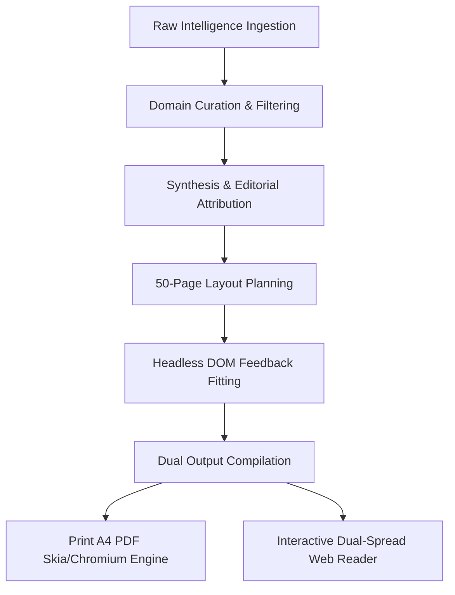
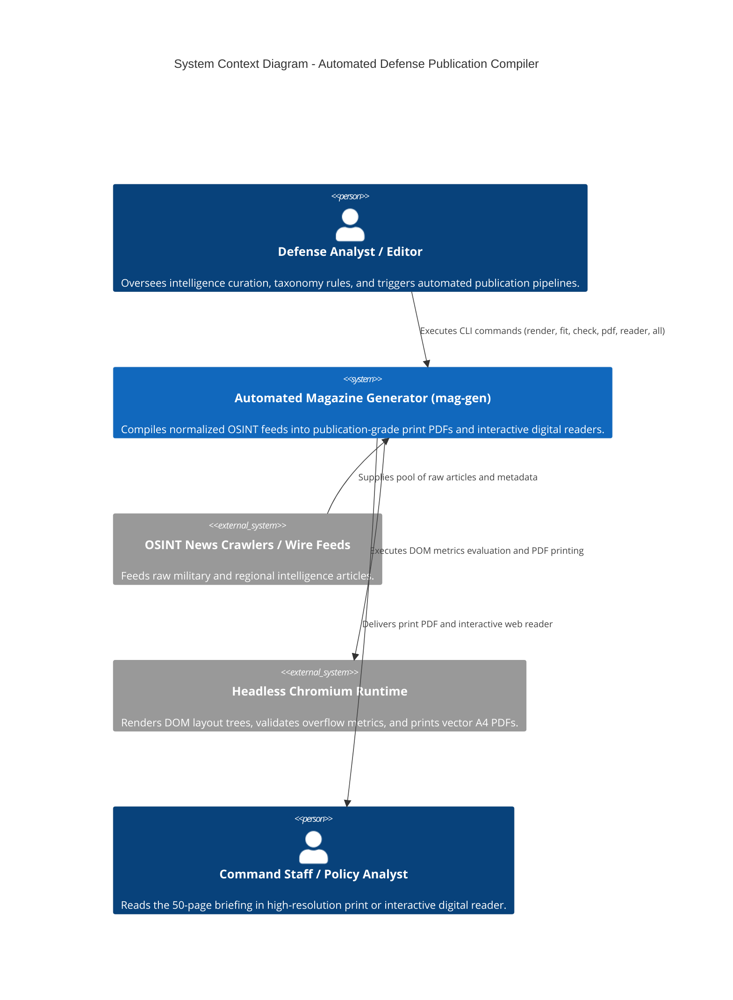
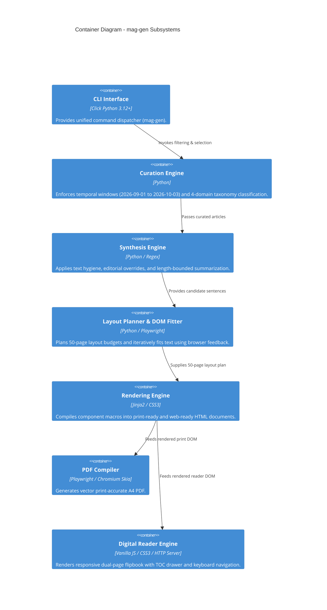
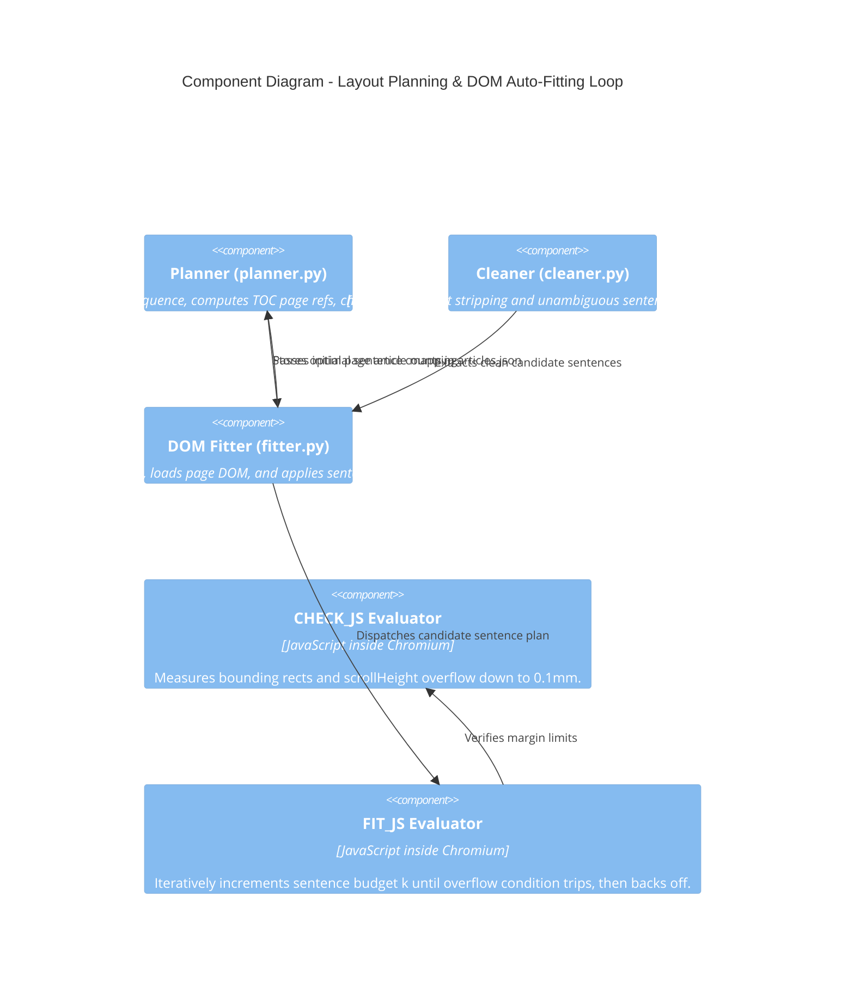
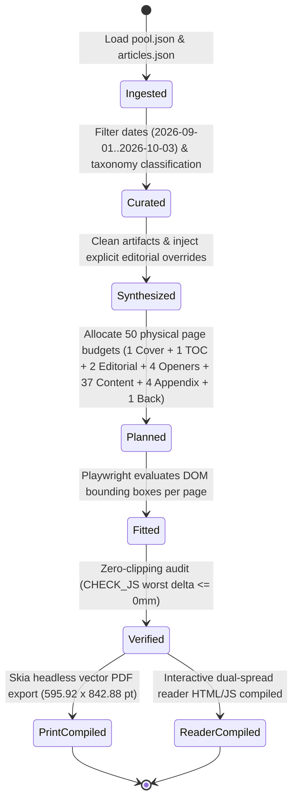

# System Design & Architecture Specification: Autonomous Defense Magazine Generator

## 1. Executive Summary

The **Autonomous Defense Magazine Generator** (`mag-gen`) is an automated digital and print publishing engine engineered to ingest, curate, synthesize, and typeset defense intelligence articles into a publication-grade, 50-page print-ready A4 document and an interactive web reader.

The system addresses the challenge of automated layout typesetting: dynamically balancing arbitrary lengths of prose across rigid physical paper constraints (210mm × 297mm) without human intervention, whitespace starvation, or text clipping.

---

## 2. C4 Architecture Specification

### 2.1 C4 Level 1: System Context Diagram

---

### 2.2 C4 Level 2: Container Diagram

---

### 2.3 C4 Level 3: Component Diagram (Layout & Fitting Engine)

---

## 3. Data Pipeline & Algorithmic State Machine

### 3.1 Sentence-by-Sentence DOM Fitting Algorithm

In traditional desktop publishing, text is either manually massaged or clipped by rigid frames. `mag-gen` uses a **browser-in-the-loop greedy expansion algorithm**:

1. **Candidate Sentence Extraction:**
   For every article slot on a page $P$, extract $S = [s_1, s_2, \dots, s_m]$ up to `MAX_WORDS = 220`.
2. **Initial Minimum Assignment:**
   Initialize each article $i$ with $k_i = 1$ sentence. Render page DOM.
3. **Iterative Greedy Growth:**
   Loop while progress can be made:
   - For each article $i$ in page $P$:
     * Increment $k_i \leftarrow k_i + 1$.
     * Replace DOM `
` element with joined sentences $s_1 \dots s_{k_i}$.
     * Audit DOM bounding boxes:
       $$\text{overflow}(P) = \exists e \in P : \text{bottom}(e) > \text{bottom}(\text{inner}) - \text{buffer} \quad \lor \quad \text{scrollHeight}(e) > \text{clientHeight}(e)$$
     * If $\text{overflow}(P) = \text{True}$:
       $$k_i \leftarrow k_i - 1; \quad \text{mark article } i \text{ as saturated}$$
     * Else:
       $$\text{progress} \leftarrow \text{True}$$
4. **Convergence:**
   The algorithm terminates when all articles on the page are saturated. This mathematically guarantees the maximum possible informative text density on each page with zero overflow.

---

## 4. Dual-Target Output Architecture

### 4.1 Print Publication Architecture (`index.html` → PDF)
- **Target Standard:** ISO 216 A4 Portrait ($210\text{mm} \times 297\text{mm}$).
- **Typography:**
  * Primary Display / Masthead: Cinzel serif (`font-weight: 800`).
  * Body Prose: Lora serif with proportional optical sizing and drop-caps (`cols-2`).
  * Captions, Folios & Metadata: Inter sans-serif.
- **Color Model:** Print-ready CSS tokens (`--ink: #111`, `--paper: #fdfdfc`, `--saffron: #c99738`, `--muted: #555`).
- **Rendering Pipeline:** Headless Playwright Chromium (`print_to_pdf`) with `print_background=True` and `@page { size: A4 portrait; margin: 0; }`.

### 4.2 Interactive Digital Reader (`reader.html`)
- **Viewport Layout:** Dark mode military operations center aesthetic (`--reader-bg: #0d1117`).
- **Modes:**
  * Dual-Page Spread View (`📖 Spread`): Side-by-side even/odd pages simulating physical magazine reading.
  * Single Page Focus View: Adaptive for smaller viewports and mobile devices.
- **Controls & Navigation:**
  * Off-canvas Table of Contents drawer with direct section jumps.
  * Folio counter (`Page X of 50`).
  * Keyboard navigation (`ArrowRight`, `ArrowLeft`, `PageUp`, `PageDown`, `Home`, `End`).
  * Fullscreen toggle (`⛶ Fullscreen`).
  * Direct 1-click download of the compiled print PDF.

---

## 5. Non-Functional Requirements & Verification Metrics

| Metric | Target | Verified Value | Validation Tool |
|---|---|---|---|
| **Total Page Budget** | Configurable (24, 32, 50, 64 pp) | 50 pages (default) | `pdfinfo`, Chromium DOM |
| **DOM Text Clipping** | 0 mm overflow | 0 mm (Pass) | `mag-gen check` (Playwright) |
| **Date Window Compliance** | 2026-09-01 to 2026-10-03 | 100% compliant | `mag-gen render` assertions |
| **PDF File Size** | < 15 MB | 9.31 MB | High-res image compression |
| **CLI Cold Execution Time** | < 15s end-to-end | ~9.2s | Linux 6.12 x86_64 |

---

## 6. Modular Subsystems Architecture

### 6.1 Pluggable Ingestion Engine (`src/magazine_generator/ingestion/`)
The ingestion pipeline decouples intelligence data sources from typesetting:
- `BaseIngestor`: Abstract protocol establishing the normalized article contract.
- `JSONIngestor`: Ingests from wire dumps and structured JSON datasets (`pool.json`, `articles.json`).
- `MarkdownIngestor`: Parses field dispatches written in Markdown with YAML frontmatter.
- `RSSIngestor`: Parses live or archived RSS 2.0 and Atom XML feeds.
- `create_ingestor(type)`: Factory dispatcher for seamless CLI ingestion (`mag-gen ingest`).

### 6.2 Layout Archetypes Registry (`src/magazine_generator/layout/registry.py`)
Layout archetypes are registered with geometric and editorial constraints:
- `lead`: 1 hero story with 108mm photo, 2-column dropcap body, 1 sidebar brief (2 articles).
- `pair`: 2 balanced vertical stories with 72mm photos (2 articles).
- `trio`: 1 top headline story + 2 compact briefing notes (3 articles).
- `quad`: 4 compact intelligence briefs in a symmetrical 2x2 grid (4 articles).
- `photo_essay`: Full-width 130mm panoramic hero photo with expansive analysis (1 article).

### 6.3 Dynamic Auto-Budgeter (`src/magazine_generator/layout/budgeter.py`)
Computes the exact layout matrix for arbitrary target page counts $T$:
- Computes front matter ($P_{\text{front}} \in \{3, 4\}$), section openers ($N_S$), and back matter ($P_{\text{back}} = 2$).
- Pro-rates content pages across sections based on available articles.
- Selects optimal layout archetypes (`lead`, `pair`, `trio`, `quad`, `photo_essay`).
- Dynamically chunks Appendix 2 rationale rows across $K$ pages without generating unwanted trailing sheets.

### 6.4 Modular Theme Subsystem (`static/css/themes/`)
CSS custom properties decouple design tokens into hot-swappable theme stylesheets:
- `army_gold.css`: Classic Army Saffron (`#d9822b`), Olive (`#4b5320`), Paper (`#fbfaf6`).
- `navy_blue.css`: Navy Deep Blue (`#0a192f`), Ocean Accent (`#0077b6`), Crisp Slate Paper (`#f8fafc`).
- `airforce_slate.css`: Air Force Steel Slate (`#1e293b`), Sky Cyan (`#0ea5e9`), Cool Paper (`#f8fafc`).
- `editorial_mono.css`: Minimalist high-contrast monochrome (`#111111`), stark rules, timeless serif.

### 6.5 Declarative YAML Configurations (`configs/`)
Replaces hardcoded parameters with version-controlled YAML specifications:
- `configs/securing_the_northeast_50p.yaml`: Full 50-page compendium specification.
- `configs/briefing_24p.yaml`: 24-page executive tactical briefing specification.
